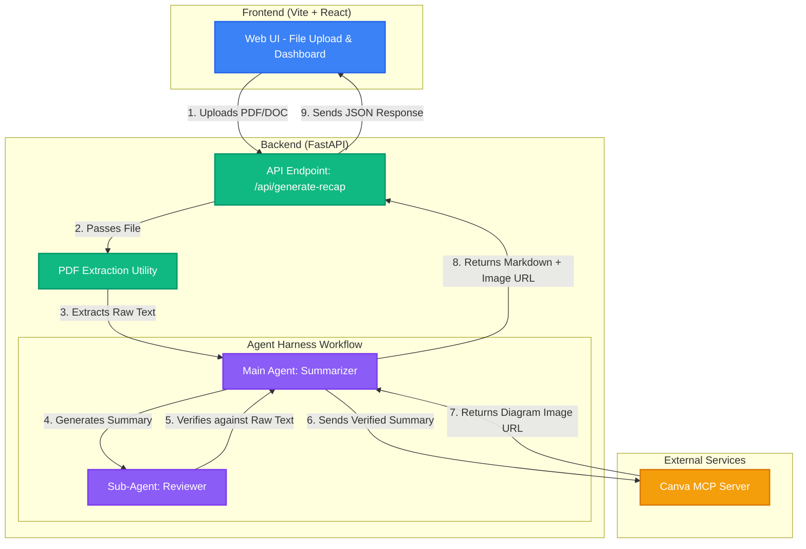

# System Architecture: Course Recap Generator

This document outlines the system architecture and data flow for the Course Recap Generator application.

## Architecture Diagram

## Component Breakdown

1. **Client (Vite + React)**
   - Responsible for presenting a rich, glassmorphic UI to the user.
   - Handles file selection and displays the final generated output (Markdown text + Canva Image).

2. **Server (FastAPI)**
   - Acts as the bridge between the web interface and the local Agent workflow.
   - Handles file reception, temporary storage, and session logging for rollbacks.

3. **PDF Extraction Utility**
   - A lightweight Python script (using PyMuPDF or PyPDF2) that strips all raw text from the uploaded documents.

4. **Agent Harness Workflow**
   - **Main Agent:** Summarizes the raw text into a structured, topic-by-topic Markdown format.
   - **Sub-Agent:** Spawns to independently verify the generated summary against the original text, ensuring no missing concepts or hallucinations.

5. **External Services (Canva MCP)**
   - The Main Agent connects to the local Canva MCP server to automatically generate a visual diagram based on the verified summary.
